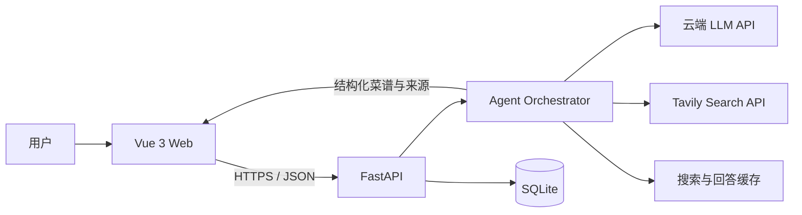

# FridgePilot 项目级实现方案

## 1. 项目目标

FridgePilot 是一个面向个人用户的冰箱食材与菜谱助手。用户以自然语言输入现有食材和做饭要求，系统解析食材与约束，联网检索真实菜谱，再将可核对来源的内容整理为清晰的烹饪指南。

本方案以可独立部署的 MVP 为目标，优先验证“食材输入 → 真实搜索 → 有来源的菜谱总结”闭环。部署目标为 2 核 2G Linux 云服务器，不在服务器运行本地大模型。

## 2. MVP 范围与非目标

### MVP 包含

- Vue 单页聊天界面，支持输入食材、忌口和烹饪要求。
- Python API 服务，负责会话、流程编排、搜索和模型调用。
- LLM Function Calling / 工具调用，将搜索过程限制在服务端定义的工具范围内。
- Tavily 联网搜索，保留菜谱标题、链接和摘要。
- 将搜索内容整理为结构化菜谱，并展示来源。
- 基础错误提示、请求超时、日志和健康检查。

### MVP 暂不包含

- 用户注册、复杂权限和多租户管理。
- 图片识别、语音输入、冰箱库存与保质期管理。
- 多 Agent、自主循环式规划和后台任务队列。
- 复杂推荐、社交分享和原生移动端。

## 3. 技术选型

| 层级 | 推荐技术 | 选择理由 |
|---|---|---|
| 前端 | Vue 3、TypeScript、Vite | 轻量、组件化，便于后续扩展独立 Web 前端 |
| UI | Vue 生态组件或少量自定义样式 | MVP 避免引入过重设计系统 |
| 后端 | Python 3.11+、FastAPI、Uvicorn | 异步 HTTP、类型清晰、易于对接 AI API |
| 数据校验 | Pydantic | 请求和模型结果的结构化校验 |
| LLM | DeepSeek、硅基流动或其他 OpenAI 兼容 API | 云端推理，不占用服务器算力 |
| 搜索 | Tavily Search API | 返回适合 AI 摘要的搜索结果 |
| 数据库 | SQLite、SQLAlchemy | 单机 MVP 部署简单；后续可迁移 PostgreSQL |
| 部署 | Docker Compose、Caddy/Nginx | 服务隔离、反向代理和 HTTPS |

前后端通过 HTTP JSON API 通信。Vue 构建产物由 Nginx/Caddy 静态托管，API 请求转发到 FastAPI。开发时分别运行 Vite 与 FastAPI。

## 4. 系统架构



### 边界约定

- Vue 负责输入、加载状态、消息展示和菜谱卡片渲染，不持有外部服务密钥。
- FastAPI 负责身份/会话标识、参数校验、限流、编排、数据保存和统一错误格式。
- Agent 编排层只处理明确步骤，不允许模型任意访问网络或执行代码。
- LLM 和 Tavily 各通过独立 Provider 适配层接入，方便更换服务商。
- SQLite 存储 MVP 所需的会话和菜谱记录；不保存不必要的个人敏感信息。

## 5. 主要业务流程

1. 用户在 Vue 输入“我有鸡蛋、番茄和葱，想做 20 分钟内的晚饭”。
2. API 校验长度和参数，创建或续用 session。
3. Agent 调用 LLM 将输入解析为食材、数量、餐次、时间、菜系和忌口等字段。
4. 根据规范化食材及约束生成有限数量的搜索词。
5. 后端调用 Tavily，获取不超过 5 条候选结果。
6. 后端清除重复 URL、截断正文、过滤明显无关结果，并保留来源链接。
7. LLM 仅基于候选内容生成结构化菜谱；无足够依据时返回信息不足状态。
8. API 校验输出 Schema、保存会话记录并返回 Vue。
9. Vue 展示菜谱步骤、食材清单、注意事项、来源链接和必要的状态提示。

Agent 流程限制为单次解析、一次搜索阶段和一次总结；最多一次结构修复，不做无上限工具循环。

## 6. 领域数据结构

### 用户约束

```json
{
  "ingredients": [
    { "name": "番茄", "quantity": "两个" },
    { "name": "鸡蛋", "quantity": "三个" }
  ],
  "meal": "晚饭",
  "max_time_minutes": 20,
  "servings": 2,
  "cuisine": null,
  "dietary_restrictions": ["不吃辣"]
}
```

### 菜谱响应

```json
{
  "title": "番茄炒蛋",
  "summary": "家常快手菜，适合工作日晚餐。",
  "prep_time_minutes": 5,
  "cook_time_minutes": 10,
  "servings": 2,
  "ingredients": ["鸡蛋 3 个", "番茄 2 个", "葱适量"],
  "steps": ["番茄切块，鸡蛋打散。", "先炒鸡蛋至凝固后盛出。"],
  "tips": [],
  "sources": [
    { "title": "番茄炒蛋做法", "url": "https://example.com/recipe" }
  ],
  "confidence": "medium"
}
```

服务端对模型结果执行类型、字段长度、步骤数和 URL 校验。来源 URL 必须来自实际搜索结果，不接受模型自行生成的 URL。

## 7. API 设计

### `POST /api/v1/chat`

请求：

```json
{
  "message": "我有鸡蛋、番茄和葱，想做简单晚饭",
  "session_id": null,
  "preferences": {
    "max_time_minutes": 20,
    "servings": 2,
    "dietary_restrictions": []
  }
}
```

响应：

```json
{
  "session_id": "opaque-session-id",
  "status": "completed",
  "recipe": {},
  "meta": {
    "search_used": true,
    "elapsed_ms": 4200
  }
}
```

当搜索结果不足时，`status` 可返回 `insufficient_sources`，并提供可读说明，不伪造菜谱来源。

### 其他接口

| 方法 | 路径 | 用途 |
|---|---|---|
| `GET` | `/api/v1/health` | 应用存活状态，不真实消耗外部 API 额度 |
| `GET` | `/api/v1/sessions/{id}/messages` | 获取会话历史（P1） |
| `GET` | `/api/v1/recipes/{id}` | 查看保存的菜谱（P1） |

API 使用统一错误格式，例如 `{ "error": { "code": "UPSTREAM_TIMEOUT", "message": "搜索暂时不可用" } }`。不要把供应商密钥、完整异常堆栈返回给浏览器。

## 8. 前端页面与交互

### MVP 页面

- 单一聊天工作区，首屏直接提供食材输入框。
- 消息区区分用户输入、状态和菜谱结果。
- 菜谱卡片包括标题、所需食材、步骤、提示和可点击来源。
- 输入区可设置人数、最长烹饪时间和忌口；默认设置保持简单。
- 请求期间禁用重复提交，并展示“正在整理食材 / 搜索菜谱 / 生成步骤”等阶段状态。
- 错误状态提供明确重试入口；网络错误时保留用户输入。

### Vue 组件建议

```text
src/
├─ api/chat.ts
├─ components/
│  ├─ ChatComposer.vue
│  ├─ ChatMessage.vue
│  ├─ RecipeCard.vue
│  └─ RecipeSources.vue
├─ types/recipe.ts
├─ views/ChatView.vue
└─ App.vue
```

组件围绕当前 MVP 工作流拆分，不预先引入复杂状态管理；若后续出现跨页面共享状态，再评估 Pinia。

## 9. Agent、Prompt 与事实约束

- 食材解析与菜谱撰写分开调用，避免模型一边猜测一边总结。
- 工具定义限制为 `search_recipes(query)`，工具实现在服务端。
- 只把精选搜索结果传给总结模型，并要求逐条关联来源。
- 不把搜索摘要中没有的烹饪时长、温度或数量伪装成事实；无法确认时标为建议或省略。
- 如果结果冲突，提示存在差异并引用对应来源。
- 若没有可用搜索结果，返回澄清问题或失败状态，不退化为无来源的“真实菜谱”。
- 将 Prompt 版本纳入日志，便于评估和回滚。

## 10. 存储与缓存

MVP SQLite 表建议：

- `sessions`: session id、创建时间、最近活动时间。
- `messages`: session id、角色、原始文本、创建时间。
- `recipes`: session id、结构化 JSON、来源 JSON、Prompt 版本、创建时间。
- `cache_entries`: 缓存键、结果 JSON、过期时间。

缓存键基于规范化食材、人数、时间限制、菜系和忌口生成。搜索缓存可设 6–24 小时，生成结果缓存可设较短 TTL。缓存内容需带过期时间和来源 URL。MVP 可暂缓持久化缓存表，若要控制成本再启用。

## 11. 配置和环境变量

```env
APP_ENV=production
APP_HOST=0.0.0.0
APP_PORT=8000

LLM_BASE_URL=
LLM_API_KEY=
LLM_MODEL=
TAVILY_API_KEY=

DATABASE_URL=sqlite:///./data/fridgepilot.db
REQUEST_TIMEOUT_SECONDS=30
MAX_SEARCH_RESULTS=5
```

`.env` 不提交到版本库；提供 `.env.example` 作为配置模板。所有服务端密钥只由后端读取。

## 12. 安全、可靠性与资源控制

- 全站 HTTPS；限制请求体和用户输入长度。
- 对单 IP 和 session 做轻量限流，防止 API 被滥用。
- 设置 LLM、搜索和整体请求超时；有限重试，只对暂时性网络错误重试一次。
- 控制单请求搜索结果数量、正文总字符数、模型输出 Token 和调用次数。
- 对用户文本和搜索网页视为不可信输入，Prompt 明确忽略网页中的指令内容。
- 输出仅允许展示安全 URL（HTTP/HTTPS），前端链接使用 `rel="noopener noreferrer"`。
- 不记录 API Key；日志避免保存完整个人输入，或提供脱敏策略。
- 2 核 2G 环境建议一个 Uvicorn worker，控制并发和连接池，SQLite 定期备份。

## 13. 错误处理

| 场景 | 处理方式 |
|---|---|
| LLM 超时或限流 | 有限重试；失败后返回可重试错误 |
| Tavily 不可用 | 若有未过期缓存则使用；否则说明当前无法检索 |
| 搜索无结果 | 返回 `insufficient_sources`，不编造来源 |
| 模型 JSON 无效 | 进行一次格式修复；仍无效则记录失败并返回通用错误 |
| 结果 URL 不在搜索集合内 | 丢弃该来源或整条不可信结果 |
| 输入过长 | 返回 422 和输入限制说明 |
| 数据库短暂不可用 | 记录服务端错误，向用户返回通用服务错误 |

## 14. 部署设计

生产链路：

```text
浏览器 → Caddy/Nginx（HTTPS、静态 Vue 文件、反向代理）→ FastAPI/Uvicorn → SQLite
```

交付配置：

- `fridgepilotweb`：构建 Vue 静态资源，由 Web Server 提供。
- `fridgepilotserver`：FastAPI 容器，单 worker 启动。
- `data`：SQLite 持久卷，容器重启后保留。
- `proxy`：自动 HTTPS 或 Nginx TLS 配置。
- Docker Compose 配置健康检查、重启策略、环境变量和日志轮转。

开发和发布流程中由 CI 执行依赖安装、测试、静态检查和前端产物生成；生产服务器只拉取已验证镜像或产物。密钥通过服务器环境配置注入。

## 15. 测试与验收标准

### 后端测试

- 食材解析 Schema 和无效输入校验。
- 搜索结果去重、截断、排序和来源白名单检查。
- Tavily / LLM Provider 使用 Mock 验证超时、错误和正常响应。
- Agent 完整流程验证有来源成功、无结果、格式错误和缓存命中。
- API 错误码及响应 Schema 测试。

### 前端测试

- 输入与偏好设置能正确提交。
- 加载、成功、无来源、网络错误等状态正确显示。
- 菜谱步骤和来源正确渲染，窄屏下内容可读。
- 连续点击不会重复发起同一请求。

### MVP 验收

1. 输入“鸡蛋、番茄和葱”能得到至少一个真实搜索来源。
2. 输入“不吃辣、20 分钟内”会影响搜索或总结结果。
3. 搜索无结果时不会输出伪造来源或宣称已验证。
4. Tavily 或 LLM 故障时界面显示可理解的错误并保留输入。
5. 服务器重启后应用可自动启动，SQLite 数据仍在。
6. 外部密钥不出现在浏览器请求、前端产物和日志中。

## 16. 分阶段交付

### P0：端到端 MVP

- Vue 聊天页面和 API 客户端。
- FastAPI 对话 API、LLM/Tavily Provider。
- 固定 Agent 流程、结构化输出和来源展示。
- 配置模板、基础日志、健康检查和 Docker 部署。
- 覆盖主流程和上游失败的测试。

### P1：提升日常可用性

- SQLite 会话历史和收藏菜谱。
- 搜索/回答缓存、忌口与个人偏好保存。
- 重新搜索、换一种做法和请求限流。
- 监控指标、备份与恢复流程。

### P2：产品扩展

- 图片识别食材和冰箱库存。
- 保质期提醒、库存消耗记录。
- 用户账户、多设备同步和个性化推荐。
- 需要并发或多用户增长时迁移 PostgreSQL/Redis，并按实际负载评估队列。

## 17. 主要风险与决策

| 风险 | 应对 |
|---|---|
| 搜索结果质量不一 | 多结果交叉、限制内容长度、保留可点击来源 |
| 模型补充未检索到的信息 | 严格提示、Schema 校验、来源必须来自搜索集合 |
| API 成本增长 | 限制调用次数、结果数和长度，按需启用缓存 |
| Vue 与后端联调成本 | 先冻结 API Schema，开发和生产使用同一接口契约 |
| MVP 范围膨胀 | 先验收真实搜索和来源可信度，再进入库存等扩展 |

## 18. 开发顺序建议

1. 定义请求、响应和菜谱 Schema，并完成 Mock 测试。
2. 实现 Tavily 与 LLM Provider 适配层。
3. 实现 Agent 固定流程和“无来源则不生成”策略。
4. 实现 FastAPI API、会话标识、错误格式和健康检查。
5. 实现 Vue 聊天页面及菜谱卡片。
6. 联调端到端场景并检查移动端布局。
7. 补充 Docker Compose、HTTPS、日志轮转和数据备份说明。
8. 按 MVP 验收项进行发布前检查。
